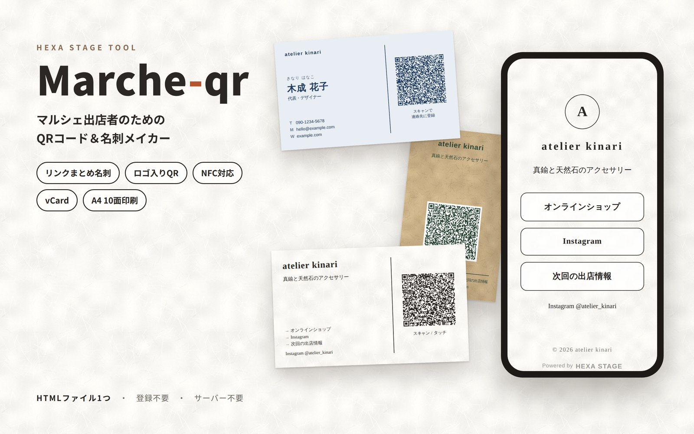

# Marché QR Maker（Marche-qr）

**マルシェや手づくり市に出店する方のための、QRコードと名刺をつくるツールです。**

お店の名前や紹介文、SNSのリンクを入力するだけで、お客さまに配る名刺と、スマホで読み取れるQRコードができあがります。商品の値札（プライスカード）も作れます。
ブラウザで開くだけで使えて、アプリのインストールや会員登録は必要ありません。

> 📟 **電子ペーパー（M5Stack PaperDIY・Santek EZ Sign）の画面づくりは、[Marché QR DIGITAL](https://github.com/tsuchicco0113-png/Marche-qr-DIGITAL) に分かれました。**
> このリポジトリは、紙に刷るもの（名刺・QRコード・プライスカード）専用です。

👉 **すぐに使う：** https://tsuchicco0113-png.github.io/Marche-qr/

---

## こんな方におすすめです

- Instagram やネットショップなど、**お店のリンクをひとつにまとめたい**
- lit.link のようなリンクまとめページは持っていないけれど、**QRコードひとつで案内したい**
- 出店ブースに置く**ショップカードを手軽に作りたい**
- 同業の作家さんや卸先の方と、**連絡先をスマートに交換したい**

---

## できること

### 🛍 店頭モード（お客さま向け）

**リンクまとめ名刺**
お店の名前・ひとこと紹介・リンク（最大5つ）を、スマホで見やすい1枚のページにまとめます。
QRコードを読み取ったお客さまには、そのページが表示されます。

**URLをそのままQRコードに**
ネットショップなど、行き先が1つだけのときはこちら。そのURLへ直接つながるQRコードを作ります。

**NFCタグにも書き込めます**
スマホをかざすだけで開ける NFCタグ（シールやキーホルダー）にも対応しています。
どの大きさのタグ（NTAG213 / 215 / 216）に入るかを、画面のメーターでお知らせします。

### 🤝 ビジネスモード（同業者・卸先向け）

名前・電話番号・メールなどを入力すると、**読み取るだけで相手のスマホの連絡先に登録される**QRコードを作ります（vCard形式）。
お店のロゴをアイコンにした連絡先ファイル（.vcf）を保存して、LINE や AirDrop で送ることもできます。
Androidで写真が付かないときは、「Android互換の.vcf」を保存してお試しください。それでも付かない機種向けに、「アイコン画像を保存」して連絡先アプリで写真に設定する方法もあります。

### 🏷 プライスカード（値札）

商品名・価格・ひとこと補足を入れると、スタンドに立てる値札ができます。
- 商品はまとめて追加できます（表計算ソフトからコピーして貼り付けもOK）
- サイズは名刺（91×55mm）、A7、L判から選ぶか、スタンドに合わせて数字で指定できます。横向き・縦向きも切り替えられます
- 価格は「¥1,200」「1,200円」、「税込」「税抜」「表記なし」から選べます
- 「売り切れ」にすると、カードにSOLD OUTの印が入ります
- 店名・ロゴや、お店のQRコード（SNSやネットショップへ）を小さく入れられます
- 商品が複数あるときは、**1商品ごとに新しいA4（名刺サイズなら10枚）**に刷れます。枚数欄を空にすると、そのシートの全面を同じカードで埋めます。枚数を入れると、その枚数だけ刷ります（10枚を超えると次のページへ続きます）
- プレビューの「この商品だけ印刷」で、1商品だけ刷ることもできます
- 「商品ごとにシートを分ける」をオフにすると、商品を続けて並べて刷ります
- 文字の大きさは、商品名・価格・補足・店名それぞれを50〜220%で変えられます
- 手書き派の方には、**手書き用の空白カード**も。枠・店名・ロゴだけを刷った台紙に、ペンで商品名と価格を書き込めます（目安線あり／なしを選べます）

名刺サイズは、名刺用紙（品番51072・10面）にそのまま刷れます。

### 🧱 HEXA STAGE のスタンドに合わせる

「立てるスタンド」で、使うスタンドを選べます（寸法は HEXA STAGE Studio のスタンドと同じ）。

| スタンド | 差せるカード | 下で隠れる高さ |
|---|---|---|
| 名刺スタンド（45°・溝4mm） | 名刺 91×55（縦 55×91 も可） | 約5mm |
| 小さな値札スタンド（45°・溝4mm） | 名刺半分 55×45.5／A8縦 52×74／A8横 74×52 | 約5mm |
| QR決済＋名刺スタンド（70°・溝8mm） | A7縦 74×105／名刺縦 55×91／正方形 80×80／はがき縦 100×148 | 約9mm |

- 選ぶと、カードの下の端（溝に隠れる所）に文字やQRが入らないように余白をとります。プレビューでは隠れる所に斜線が出ます（印刷はされません）
- カードがスタンドに合わないときはお知らせが出て、「スタンドに合うサイズにする」で直せます
- 「スタンドの色」（HEXA STAGE で売っている色）を選ぶと、その色に合うカードの組み合わせ（紙・質感・インク、QRカードは帯の色も）を2〜3個おすすめします。プレビューでは隠れる所がスタンドの色で塗られます。色の一覧は HTML の `STAND_COLORS`（id は HEXA STAGE Studio の filaments.json と同じ）
- プライスカードのサイズに、名刺半分・A8・正方形80・はがきを追加しました
- 「文字の並び → 自由に配置」で、商品名・価格・補足・店名・QRを、プレビューのカード上でドラッグして好きな場所に置けます（ホイールでその文字だけ大きさを変更）。位置はカードに対する割合なので、サイズを変えても同じ並びのまま広がります

### 🔳 QRカード（QR決済＋名刺スタンド用）

決済（PayPayなど）の店舗QR、SNS・ショップのQR、連絡先のQRを、見出し付きの1枚のカードにして印刷します。
- サイズは QR決済＋名刺スタンドの溝に合わせた縦向き：A7縦 74×105／名刺縦 55×91／正方形 80×80／はがき縦 100×148
- 入れるQR：URLを入れる／QRの画像を貼る（決済サービスが発行した画像）／店頭モードのQR／ビジネスモードの連絡先
- 見出し（帯・下線・なし、帯の色7色、「お支払いはこちら」などのひな形）、店名・ロゴ、QRの下のひとこと、補足（使えるお支払いなど）
- QRは残った場所いっぱいの大きさに自動で広げます。スタンドの溝に隠れる下の約9mmには何も置きません
- A4にまとめて印刷（名刺縦は名刺用紙 51072 に90°回して刷ります）
- スタンドの「NFCタグコイン：QRカードの裏」に合わせて、「スマホをかざしてもOK」の印を入れられます。プレビューには裏のコイン（φ30）の位置を青い点線で出し、コインに書き込むURLが NTAG213/215 に入るかも確かめられます

### 🎨 デザイン

- QRコードの真ん中に、お店のロゴを入れられます
- 紙の色や質感（和紙・クラフト紙・画用紙・布目）、書体、文字の色を選んで、お店の雰囲気に合わせられます
- 名刺のレイアウトは4種類（横型・縦型・写真メイン・写真背景）。写真は位置や大きさを調整できます

### 🖨 印刷・保存

- **A4サイズの名刺用紙（10面・91×55mm）**にそのまま印刷できます
- 印刷位置は 0.1mm 単位で調整できます。ずれを確かめる「位置確認シート」も印刷できます
- QRコードは画像（PNG / SVG）として保存できます。チラシやポップにもお使いください
- 入力した内容はファイル（JSON）に保存しておき、あとから読み込み直せます。Marché QR DIGITAL とも同じ形式なので、屋号・リンク・商品と価格をそのまま行き来できます
- PCで作った設定は「スマホに設定を送る（QR）」で、スマホにそのまま渡せます（ロゴ・写真は入りません）

---

## 使い方

### 基本の流れ

1. [ツールのページ](https://tsuchicco0113-png.github.io/Marche-qr/)を開きます
2. 左上で「店頭モード」「ビジネスモード」「プライスカード」から選びます
3. 左側の欄に、お店の名前やリンクを入力します
4. 右側に、名刺・QRコード・リンクページの見本がすぐに表示されます
5. 「名刺を印刷」ボタンで印刷するか、QRコードを画像で保存してお使いください

入力した内容は、お使いのブラウザに自動で保存されます。次に開いたときも続きから作業できます。

### NFCタグに書き込むとき

1. 左下の「URLコピー」ボタンを押します
2. スマホアプリ「**NFC Tools**」（iPhone・Android とも無料）を開きます
3. 書き込み（Write）の画面で「**URL**」のレコードを追加し、コピーした内容を貼り付けて書き込みます

読み取る側のお客さまは、アプリを入れる必要はありません。スマホをかざすだけで開きます。

---

## 印刷のときのコツ

印刷画面では、次のように設定してください。

| 項目 | 設定 |
|---|---|
| 用紙サイズ | A4 |
| 倍率 | 100%（「実際のサイズ」） |
| 余白 | なし |

プリンターによっては、少し位置がずれることがあります。
本番の名刺用紙に印刷する前に、普通紙で「**位置確認シート**」を印刷してください。名刺用紙に重ねて光に透かし、線と切れ目が合っているかを確かめると安心です。
ずれていたときは「位置の微調整」で補正できます。

---

## 安心してお使いいただくために

- 入力した内容は、**お使いのブラウザの中にだけ保存されます**。どこかのサーバーに送られることはありません
- リンクまとめページの内容は、QRコードのURLそのものに詰めて入っています。そのため、ページを置いておくサーバーやデータベースは不要です
- 内容を変えたいときは、QRコードやNFCタグを作り直してください

### 動作環境

Chrome・Edge・Safari・Firefox の最新版でお使いいただけます。パソコンでもスマートフォンでも動きます。

---

## ご自分のサイトに置いて使う（上級者向け）

このツールは `index.html` というファイル1つでできています。
ご自分のホームページや Netlify などに置いて使うこともできます。そのときは、QRコードを読み取ったお客さまにもそのページが表示されます。

GitHub でこのリポジトリをコピー（Fork）した場合は、**Settings → Pages** で Branch を `main`、フォルダを `/ (root)` にして保存すると、ご自分の公開ページになります。

---

## ライセンス

[MIT License](LICENSE) で公開しています。
個人・お店・会社を問わず、どなたでも無料で使ったり、作り変えたり、配ったりできます。
作り変えて配るときは、著作権表示とライセンスの文章を一緒に残してください。

---

Powered by [HEXA STAGE](https://hexa-stage.booth.pm/) — 滋賀県甲賀市土山町
